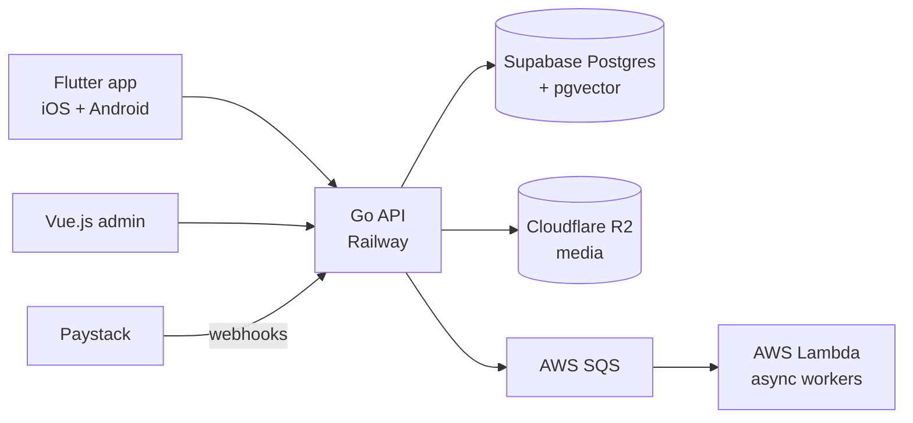

<h1>Ted Bankong</h1>

**Engineering lead and full-stack engineer in Lagos, Nigeria.**
I design and build products end to end: mobile apps, backend services, payments, search, infrastructure, and software that talks to hardware.

5+ years shipping across fintech, commerce, defence, logistics, and legal tech. I've led engineering teams, co-founded a company, and taken products from a blank page to the App Store and Play Store.

  
  
  

---

## What I'm building

### Terra Industries · Full-Stack Engineer
Software for security and surveillance infrastructure that runs on real hardware in the field.

- Architected and built **Sentinel** from scratch, a real-time monitoring system for a network of distributed sentry towers.
- Live alerts over **server-sent events**, plus control interfaces for operating towers remotely.
- Media processing pipelines feeding **AI inference models** for threat detection, classification, and incident reports on live streams.
- Work spans Go, Supabase, IP cameras, networking, and command-and-control interfaces. I'm also contributing to drone and gimbal systems.

### Rewear · Co-Founder & Technical Lead
An AI-enabled social commerce platform for fashion sellers in Nigeria. Live on iOS and Android with 500+ users. [rewearapp.com](https://rewearapp.com)

I designed the architecture and led engineering across every layer:

- **Hybrid search.** Full-text search and multimodal vector embeddings (pgvector), merged with Reciprocal Rank Fusion. Buyers can search with words or with a photo.
- **Payments.** Checkout, escrow-style transaction flows, seller balances, settlements, and payouts on Paystack. Orders move through explicit states so a payment is never the end of the story.
- **AI listings.** Turns product photos and existing seller content into structured listings, including importing inventory straight from a seller's Instagram.
- **Logistics.** Delivery fees, fulfilment, and order tracking built into the purchase flow.
- **Operations.** Auth, notifications, observability, release pipelines, and deployment for mobile and backend.

### Stead · Co-Founder
A group working across housing, business FX, and software. Through Stead Innovations we build products for companies and institutions, including voter accreditation software for **LASIEC**, the Lagos State Independent Electoral Commission.

---

## Previously

| Where | Role | Highlights |
| --- | --- | --- |
| **Saleswave** | Flutter Engineer | Rebuilt the Legalpedia desktop app and migrated 17,000+ legal cases with zero data loss. Real-time GPS tracking and route optimization for Faramove and Roppi. |
| **Edge** | Engineering Team Lead | Led a multidisciplinary team building iCase, a legal tech platform. Owned architecture, sprint planning, code review, and delivery. |
| **Edge** | Mobile Engineer | Flutter and Kotlin apps. Native platform channels for camera, biometrics, and notifications. |
| **BlinxHQ** | Lead Mobile Engineer | Fintech automation app with real-time transaction monitoring. KYC with Smile Identity and Metamap. Supabase row-level security. OTA updates with Shorebird. |
| **Amaswitch** | Mobile Developer | Fintech app integrating 9 payment service banks and full KYC flows. Biometric auth and Fastlane CI/CD. |
| **Appceiv** | Senior Frontend Developer | Led remote frontend teams on React, Vue, and Next.js. Wrote and audited Ethereum smart contracts. |
| **NAMA** | Database Administrator | Data validation, consistency scripts, and backup and recovery for the Nigerian Airspace Management Agency. |

---

## Stack

**Languages**

**Mobile and web**

**Backend**

**Data and infrastructure**

**Areas I go deep on:** payment systems, real-time systems (SSE and WebSockets), search and embeddings, API design, KYC and identity verification, mobile CI/CD, and software that controls hardware.

---

## How I work

- I start from the problem and the people who have it, then pick the simplest system that solves it.
- I own things end to end: architecture, code, deployment, monitoring, and what happens when it breaks in production.
- As a lead, my job is to clear the path. I break work down, review code, unblock engineers, and keep technical decisions tied to what the business needs.

> Most of my production work lives in private company repositories. Happy to walk through any of the systems above in more detail.

---

Away from the screen: cars, photography, and industrial design.
